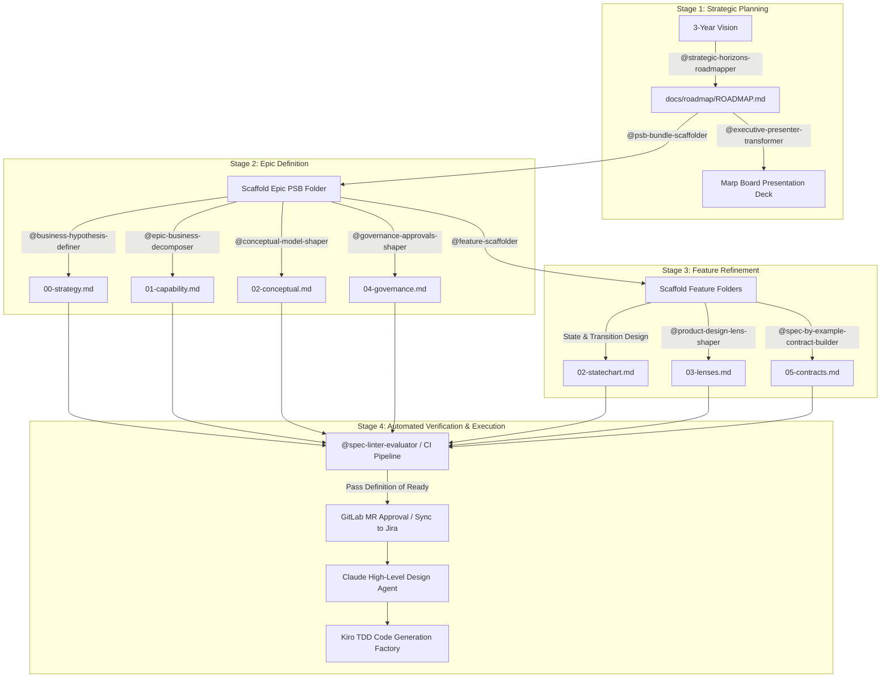

# Spec-Driven Product Design Framework (SDPF) for Kiro & Claude Code Factory

A specification-driven product design framework for enterprise banking environments. This framework transitions Product Owners (POs) from PowerPoint slides and loose Word documents into version-controlled **GitLab Markdown artifacts (Roadmap as Code & Spec as Code)**.

The resulting **Product Specification Bundle (PSB)** produces deterministic, machine-verifiable requirements ready for automated ingestion by downstream **Claude High-Level Design (HLD)** and **Test-Driven Development (TDD) Code Generation Agents**.

---

## 1. Operating Architecture & Granularity Split

To prevent context bloat and ambiguity, requirements are strictly divided into **Macro-Context (Epic Level)** and **Micro-Execution (Feature Level)**:

```text
product-design-skill/
├── .kiro/
│   └── skills/                                  # Active Kiro Skills (Interactive Agents)
│       ├── strategic-horizons-roadmapper.md
│       ├── business-hypothesis-definer.md
│       ├── epic-business-decomposer.md
│       ├── executive-presenter-transformer.md
│       ├── psb-bundle-scaffolder.md
│       ├── feature-scaffolder.md
│       ├── conceptual-model-shaper.md
│       ├── governance-approvals-shaper.md
│       ├── product-design-lens-shaper.md
│       ├── spec-by-example-contract-builder.md
│       └── spec-linter-evaluator.md
│
├── templates/
│   └── psb/                                     # Reusable Blank Starter Schemas
│       ├── epic/
│       │   ├── 00-strategy.md                   # Commercial hypothesis & KPIs
│       │   ├── 01-capability.md                 # Scope boundaries & feature breakdown
│       │   ├── 02-conceptual.md                 # Ubiquitous domain lexicon & OOUX object map
│       │   └── 04-governance.md                 # PRA/FCA mandates, SMCR sign-off & DPIA
│       └── feature/
│           ├── 02-statechart.md                 # Finite state machine, transitions & guards
│           ├── 03-lenses.md                     # Failure modes, blast radius & telemetry
│           └── 05-contracts.md                  # Interface schemas & Given-When-Then tables
│
└── docs/                                        # Working Project Artifacts
    ├── roadmap/
    │   └── ROADMAP.md                           # 3-Year Strategic Horizon Roadmap
    └── specs/
        └── EPIC-104-party-resolution/           # Populated Epic-Level Bundle
            ├── 00-strategy.md
            ├── 01-capability.md
            ├── 02-conceptual.md
            ├── 04-governance.md
            └── features/
                ├── FEAT-01-exact-matching/      # Populated Feature-Level Bundle
                │   ├── 02-statechart.md
                │   ├── 03-lenses.md
                │   └── 05-contracts.md
                └── FEAT-02-quarantine-workflow/
                    ├── 02-statechart.md
                    ├── 03-lenses.md
                    └── 05-contracts.md
```

---

## 2. End-to-End Workflow

The framework follows a 4-stage pipeline that lowers high-level business vision into machine-executable test matrices:



---

## 3. Step-by-Step User Guide for Product Owners

### Step 1: Establish the 3-Year Strategic Roadmap
Ditch static slide decks. Start inside Kiro to map portfolio outcomes into the **Three Horizons Model** (Now / Next / Later).

1. In Kiro, run:
   ```text
   /roadmap
   ```
   *(or invoke `@strategic-horizons-roadmapper`)*
2. Answer the interview prompts regarding strategic themes and delivery horizons.
3. Kiro generates `docs/roadmap/ROADMAP.md` complete with an embedded, dynamic **Mermaid.js Gantt timeline**.
4. *(Optional)* To generate an executive deck for senior stakeholders, run:
   ```text
   /present
   ```
   Kiro synthesizes `ROADMAP.md` into `docs/presentations/EXEC-ROADMAP-DECK.md` using clean Marp slide syntax.

---

### Step 2: Scaffold a Product Specification Bundle (PSB)
Once an initiative on your roadmap is slated for refinement, scaffold its Epic package.

1. In Kiro, run:
   ```text
   /scaffold-psb
   ```
2. Specify the initiative ID and slug (e.g., `EPIC-104-party-resolution`).
3. Kiro clones the starter templates from `templates/psb/epic/` into `docs/specs/EPIC-104-party-resolution/`.

---

### Step 3: Populate Epic-Level Macro-Context
Flesh out the business constraints and domain concepts that apply across all features in the Epic:

1. **Strategic Hypotheses & KPIs (`00-strategy.md`):**
   * Run `/hypothesis` (or invoke `@business-hypothesis-definer`).
   * Establishes the commercial rationale, leading indicators, and the kill/pivot threshold.
2. **Capability Boundaries & Feature Slicing (`01-capability.md`):**
   * Run `/decompose` (or invoke `@epic-business-decomposer`).
   * Slices the Epic into 3–5 vertical features with non-technical Business Acceptance Criteria (BAC).
3. **Domain Vocabulary & Conceptual Object Model (`02-conceptual.md`):**
   * Run `/model-objects` (or invoke `@conceptual-model-shaper`).
   * Harvests domain nouns, eliminates synonyms, and defines entity relationships and cardinality (OOUX).
4. **Governance, SMCR & Regulatory Invariants (`04-governance.md`):**
   * Run `/governance` (or invoke `@governance-approvals-shaper`).
   * Maps PRA/FCA regulatory regimes, PII data classifications, and required committee sign-off gates.

---

### Step 4: Scaffold and Shape Child Features
Features represent vertical, independently testable slices. Each feature lives in its own subdirectory under `features/`.

1. **Scaffold the Feature:**
   * In Kiro, run:
     ```text
     /scaffold-feature
     ```
   * Specify the parent Epic and Feature name (e.g., `FEAT-01-exact-matching`).
   * Kiro provisions `features/FEAT-01-exact-matching/` with starter templates for `02-statechart.md`, `03-lenses.md`, and `05-contracts.md`.
2. **Define Entity State Transitions (`02-statechart.md`):**
   * Define the finite state machine, legal transitions, guard conditions, and idempotency rules.
3. **Interrogate System & Operational Lenses (`03-lenses.md`):**
   * Run `/shape-lenses` (or invoke `@product-design-lens-shaper`).
   * Answers the 6 failure and system lenses: Lifecycle, Premortem, Actor Intent, Blast Radius, Observability, and Reversibility.
4. **Build Executable Contracts & Spec-by-Example (`05-contracts.md`):**
   * Run `/spec-contract` (or invoke `@spec-by-example-contract-builder`).
   * Generates formal interface schemas and tabular Given-When-Then test matrices covering Nominal, Boundary, and Failure scenarios.

---

### Step 5: Audit & Lint Before Engineering Handoff
Before handing specifications to Claude or engineering teams, verify that the requirements satisfy the **LLM Definition of Ready (DoR)**.

1. In Kiro, run:
   ```text
   /lint-spec
   ```
   *(or invoke `@spec-linter-evaluator`)*
2. The linter audits the bundle across 6 quality gates:
   * **Semantic Ambiguity:** No undefined domain nouns or forbidden synonyms.
   * **Cardinality Rigor:** Entity relationships are explicitly bounded.
   * **State Completeness:** Statechart has no dead-ends or unhandled transitions.
   * **Edge-Case Density:** At least 1 nominal, 2 boundary, and 2 failure cases per feature.
   * **Regulatory Traceability:** Every PII field maps to an audit and retention policy.
   * **Zero Solution Leakage:** No premature technical implementation mentions (e.g., Kafka, Mongo, AWS).
3. If all gates pass, `SPEC-LINT-REPORT.md` is marked `APPROVED FOR CLAUDE HLD`.

---

## 4. Downstream Factory Protocol: Feeding Claude Agents

When invoking your downstream Claude Code Factory, use the following context injection pattern:

```text
Context:
- docs/specs/EPIC-104-party-resolution/00-strategy.md
- docs/specs/EPIC-104-party-resolution/01-capability.md
- docs/specs/EPIC-104-party-resolution/02-conceptual.md
- docs/specs/EPIC-104-party-resolution/04-governance.md
- docs/specs/EPIC-104-party-resolution/features/FEAT-01-exact-matching/02-statechart.md
- docs/specs/EPIC-104-party-resolution/features/FEAT-01-exact-matching/03-lenses.md
- docs/specs/EPIC-104-party-resolution/features/FEAT-01-exact-matching/05-contracts.md

Execution Rules:
1. High-Level Design: Generate architectural diagrams and components conforming strictly to the entities in 02-conceptual.md and state guards in 02-statechart.md.
2. TDD Unit Test Synthesis: Synthesize unit tests asserting every single row in the Given-When-Then matrix of 05-contracts.md before generating domain code.
3. Invariant Enforcement: Enforce PII masking and audit logging constraints declared in 04-governance.md.
```

---

## 5. Summary of Kiro Commands & Skills Reference

| Command | Skill Name | Scope | Output Artifact |
| :--- | :--- | :--- | :--- |
| `/roadmap` | `@strategic-horizons-roadmapper` | Portfolio | `docs/roadmap/ROADMAP.md` |
| `/present` | `@executive-presenter-transformer` | Portfolio | `docs/presentations/EXEC-ROADMAP-DECK.md` |
| `/scaffold-psb` | `@psb-bundle-scaffolder` | Epic | `docs/specs/EPIC-{id}/` |
| `/hypothesis` | `@business-hypothesis-definer` | Epic | `00-strategy.md` |
| `/decompose` | `@epic-business-decomposer` | Epic | `01-capability.md` |
| `/model-objects`| `@conceptual-model-shaper` | Epic | `02-conceptual.md` |
| `/governance` | `@governance-approvals-shaper` | Epic | `04-governance.md` |
| `/scaffold-feature` | `@feature-scaffolder` | Feature | `docs/specs/EPIC-{id}/features/FEAT-{id}/` |
| `/shape-lenses` | `@product-design-lens-shaper` | Feature | `features/FEAT-{id}/03-lenses.md` |
| `/spec-contract`| `@spec-by-example-contract-builder`| Feature | `features/FEAT-{id}/05-contracts.md` |
| `/lint-spec` | `@spec-linter-evaluator` | Epic / Feat | `SPEC-LINT-REPORT.md` |
