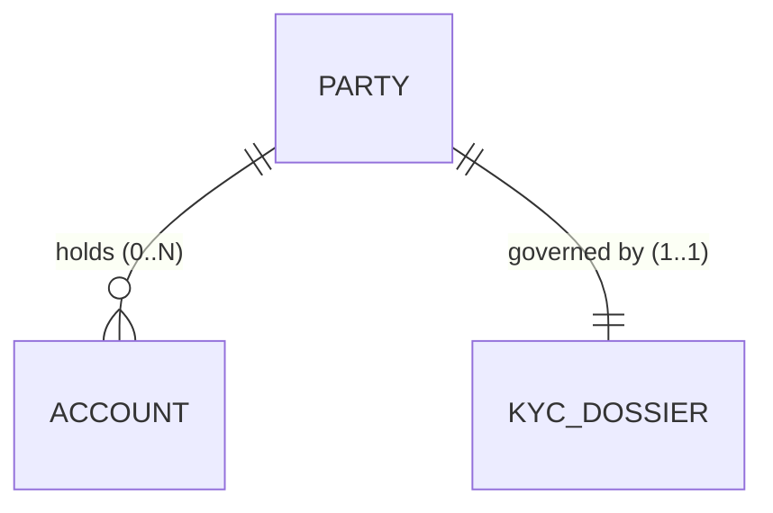

# 1. Ubiquitous Domain Lexicon
> Every domain noun used across this Epic and its child Features must be defined below. Synonyms listed in the right-hand column are strictly forbidden in specifications, API schemas, and code.

| Term | Exact Business Definition | Synonyms to STRICTLY Avoid |
| :--- | :--- | :--- |
| **Party** | A single legal person or registered corporate entity verified by the bank. | Customer, Client, User, Contact |
| **Account** | A financial product ledger held by one or more verified Parties. | Profile, Wallet, Bucket |
| **[Domain Term]** | [Exact, unambiguous definition within this bounded context] | [Forbidden synonyms] |

---

# 2. Conceptual Object Model (OOUX)

### Entity 1: `Party`
- **Business Identity (Immutable Attributes):** `party_id`, `incorporation_date`
- **Mutable Attributes:** `legal_name`, `tax_residence_jurisdiction`, `verification_tier`
- **Lifecycle Summary:** `Ingested` -> `Verified` -> `Active` -> `Suspended` -> `Archived`
- **Deletion & Retention Invariant:** Cannot be deleted while linked to an active `Account`; subject to 7-year post-relationship retention.

### Entity 2: `[Entity Name]`
- **Business Identity (Immutable Attributes):** `[id_field]`
- **Mutable Attributes:** `[attribute_1]`, `[attribute_2]`
- **Lifecycle Summary:** `[State A]` -> `[State B]` -> `[State C]`
- **Deletion & Retention Invariant:** `[Business constraint governing archival or deletion]`

---

# 3. Entity Relationships & Cardinality Matrix

| Source Entity | Relationship Verb | Target Entity | Cardinality | Existence Dependency & Invariant |
| :--- | :--- | :--- | :--- | :--- |
| **Party** | holds | **Account** | `1 : 0..N` | A Party may exist with 0 Accounts; an Account cannot exist without at least 1 Party. |
| **Party** | governed by | **KYC Dossier** | `1 : 1` | A Party cannot transition to `Active` without exactly 1 approved KYC Dossier. |
| **[Source]** | [verb] | **[Target]** | `[1:1 / 1:N / M:N]` | [Explicit rule on orphan prevention and cascading constraints] |
