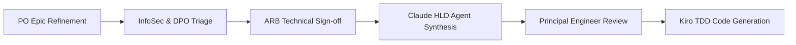

# 1. Regulatory Regimes & System Invariants

| Regime / Mandate | Applicability | Mandatory System Invariant for Claude HLD |
| :--- | :--- | :--- |
| **PRA SS1/21 (Operational Resilience)** | Yes / No / Partial | Explicit Impact Tolerance: Maximum allowable service disruption is `[X]` minutes. |
| **FCA Consumer Duty** | Yes / No / Partial | Must record and evidence fair outcomes and exception handling for vulnerable customer cohorts. |
| **UK GDPR / Data Protection Act 2018** | Yes / No / Partial | Automated cryptographic erasure / redaction workflow for Article 17 Right-to-Erasure requests (subject to AML overrides). |
| **BCBS 239 (Risk Data Aggregation)** | Yes / No / Partial | Immutable, timestamped audit lineage from upstream source feed to golden record mutation. |
| **PRA SS1/23 (Model Risk Management)** | Yes / No / Partial | Deterministic audit log of all heuristic/model decision weights, thresholds, and override reasons. |

---

# 2. SMCR Accountability & Risk Ownership
- **SMF Accountable Executive:** `[e.g., SMF24 - Chief Operating Officer / SMF16 - Compliance Oversight]`
- **Designated Business Risk Owner:** `@[risk-owner-handle]`
- **Operational Resilience Classification:** `[Important Business Service (IBS) | Core Internal Service | Standard]`

---

# 3. Data Classification, Privacy (DPIA) & Sovereign Residency
- **Highest Data Classification Tier:** `[Public | Internal | Confidential | Restricted PII | Special Category GDPR Art. 9]`
- **Sovereign Data Residency Constraints:** `[e.g., All data at rest and in transit must remain strictly within UK sovereign cloud regions (eu-west-2 London)]`
- **Data Protection Impact Assessment (DPIA):** `[Not Required | In Progress | Approved by DPO - Ref: DPIA-XXXX]`
- **Retention & Purge Policy:** `[e.g., Retain immutable audit and KYC records for 7 years post relationship termination, then execute automated cryptographic purge]`

---

# 4. Governance Approval Matrix & Gateways

### Mandatory Pre-HLD / Pre-Production Sign-off Gates
- [ ] **Information Security (InfoSec):** Threat model and encryption/masking invariants approved.
- [ ] **Data Privacy Office (DPO):** DPIA and retention/purge schedules signed off.
- [ ] **Architecture Review Board (ARB):** Domain boundaries and operational resilience tolerances verified.
- [ ] **Operational Risk Committee (ORC):** Exception handling and manual fallback runbooks approved.
