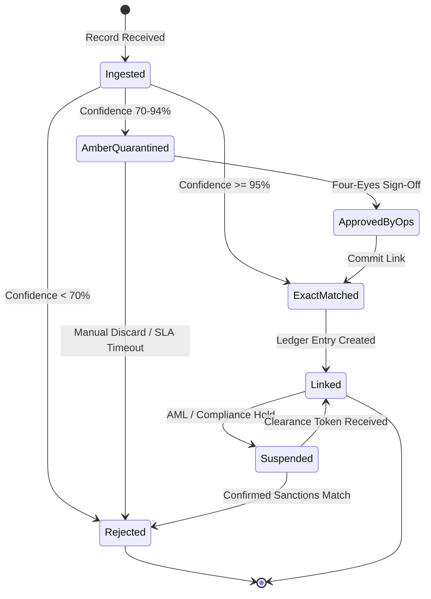

# 1. Finite State Machine Visualization (Mermaid.js)
> Every state referenced here must map to an entity defined in the parent Epic's `02-conceptual.md`. No unreachable or dead-end non-terminal states are permitted.

---

# 2. State Transition & Guard Condition Table

| Current State | Trigger / Domain Event | Guard Condition (Pre-Condition) | Next State | Post-Condition / Emitted Event |
| :--- | :--- | :--- | :--- | :--- |
| `[None / *]` | `RecordSubmitted` | Payload schema valid & idempotency key unseen | `Ingested` | Emit `RecordIngestedEvent` |
| `Ingested` | `MatchEvaluated` | `match_confidence >= 0.95` AND `sanctions_flag == false` | `ExactMatched` | Emit `ExactMatchConfirmedEvent` |
| `Ingested` | `MatchEvaluated` | `0.70 <= match_confidence < 0.95` | `AmberQuarantined` | Route to Ops Quarantine Queue |
| `Ingested` | `MatchEvaluated` | `match_confidence < 0.70` | `Rejected` | Emit `RecordRejectedEvent` |
| `AmberQuarantined` | `OpsDecisionRecorded` | `approver_id != submitter_id` (Four-Eyes Guard) | `ApprovedByOps` | Audit decision with `approver_id` |
| `AmberQuarantined` | `QuarantineTimerExpired` | `elapsed_time > 72h` | `Rejected` | Emit `QuarantineExpiredEvent` |

---

# 3. Concurrency, Idempotency & Out-of-Order Handling
- **Idempotency Invariant:** [e.g., Duplicate events carrying the same `idempotency_key` within a 24-hour window must return the existing state without re-triggering side effects or duplicate ledger entries.]
- **Optimistic / Pessimistic Concurrency Rule:** [e.g., State mutations must assert `entity_version`; concurrent conflicting updates fail fast with a `VERSION_CONFLICT` rejection.]
- **Out-of-Order Event Resolution:** [e.g., If a `ClearanceTokenReceived` event arrives before `Suspended`, buffer in a pending state for up to 15 minutes before routing to the Dead-Letter / Exception Queue.]
